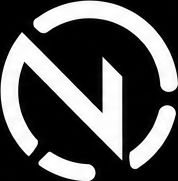
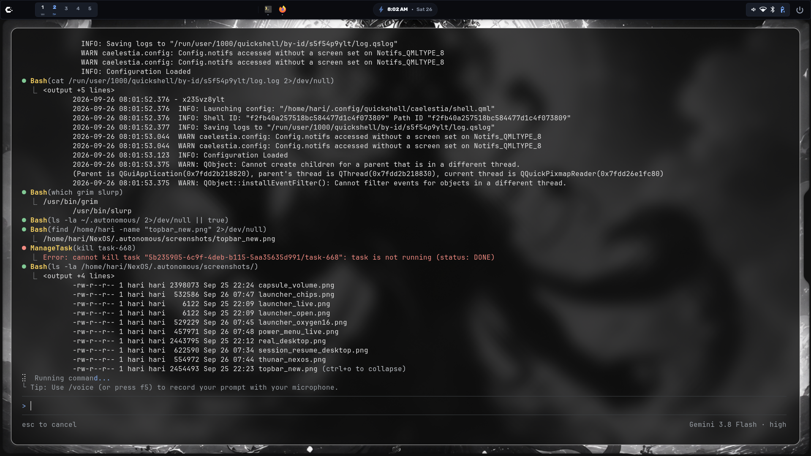
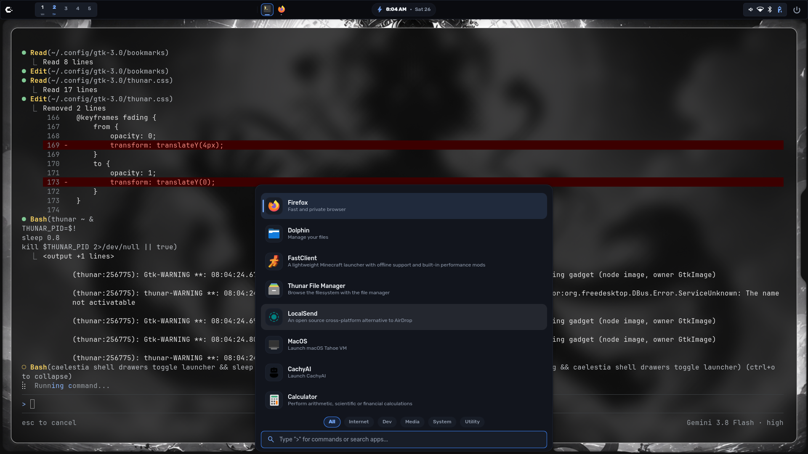
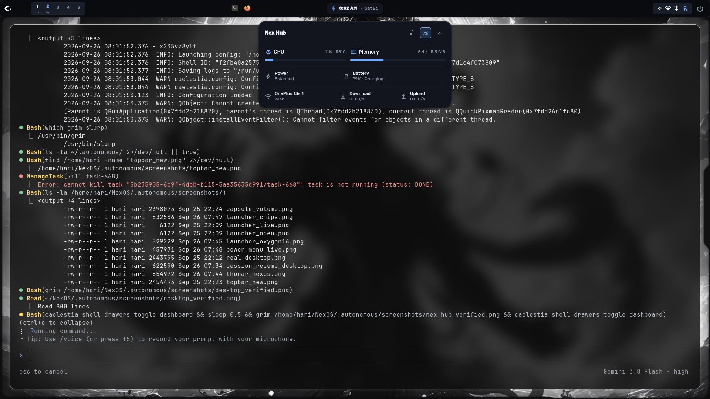
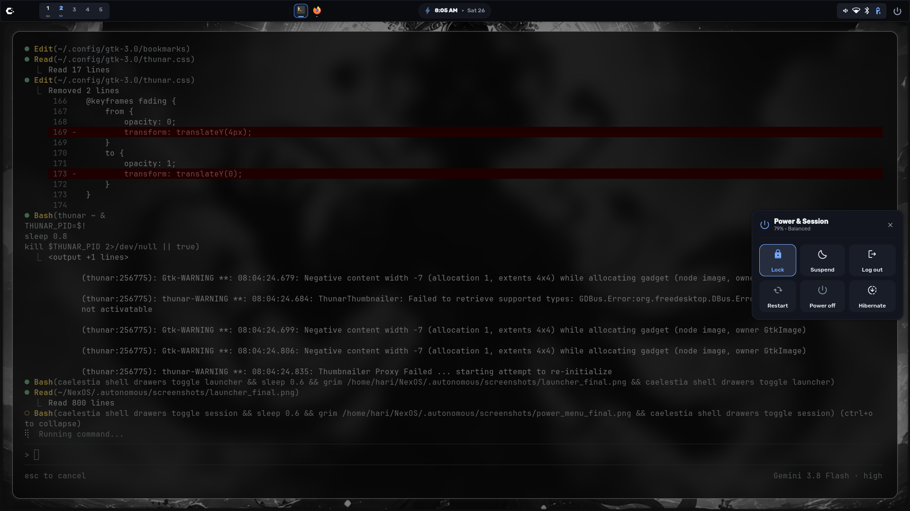

<div align="center">

# NexOS

**Precision Linux Desktop Environment built on Hyprland, Quickshell & CachyOS**

[](LICENSE)
[](https://wayland.freedesktop.org/)
[](https://hyprland.org/)
[](https://git.outfoxxed.me/outfoxxed/quickshell)
[](https://cachyos.org/)

<p align="center">
  
</p>

*A cohesive, high-performance desktop experience guided by the Liquid Glass and OxygenOS-for-PC design philosophy — restrained optical depth, fluid spatial transitions, intentional ergonomics, and zero AI-rice clutter.*

</div>

---

## Visual Showcase

### Clean Desktop & Dynamic Island


### Centered Application Launcher & Categories


### Control Center & System Telemetry


### Unified Session Matrix


---

## Core Highlights

- **Dynamic Island Topbar**: Continuous compact topbar with a morphing center capsule that adapts fluidly to volume changes, AC charging status, audio playback, and system notifications.
- **Instant Resident Control Center (`SUPER + S`)**: Preloaded control surface providing zero-latency toggles for Wi-Fi, Bluetooth, displays, audio devices, and power profiles.
- **Centered Floating Launcher (`SUPER + Space`)**: Modern, keyboard-driven application menu with category filter chips (`All`, `Internet`, `Dev`, `Media`, `System`, `Utility`).
- **Native Hyprland Lua Integration**: Clean, modular Lua configuration driving compositor layout, 4-pass backdrop blur, and custom animation curves.
- **Hardware Boot Identity (NexBoot)**: 130-frame Plymouth boot assembly animation seamlessly synchronized with a custom SDDM login greeter.
- **100% Reversible & Safe**: Automated timestamped backups before configuration changes, idempotent installer, and a single-command uninstaller.

---

## Installation

### Method 1: Clone & Inspect (Recommended)
Review the codebase and simulate changes before applying them:

```bash
git clone https://github.com/hari-dev0x/NexOS.git
cd NexOS

# Run a dry-run check:
./install.sh --dry-run

# Execute installation:
./install.sh
```

### Method 2: One-Command Installation
For clean setup on Arch Linux or CachyOS:

```bash
curl -fsSL https://raw.githubusercontent.com/hari-dev0x/NexOS/main/install.sh | bash
```

> [!NOTE]
> Piping remote scripts to bash executes commands directly. Inspect the reviewed [install.sh](https://raw.githubusercontent.com/hari-dev0x/NexOS/main/install.sh) script before running remote commands.

### Installer Flags
| Option | Description |
| :--- | :--- |
| `-y`, `--yes` | Non-interactive mode (auto-accepts prompts) |
| `--dry-run` | Audits dependencies and outputs planned actions without writing to disk |
| `--no-deps` | Skips package manager; installs desktop configurations only |
| `--boot` | Deploys Plymouth boot splash and SDDM greeter (requires root) |
| `--uninstall` | Removes NexOS configurations and offers backup restoration |

---

## Keybindings Cheat Sheet

| Shortcut | Action | Subsystem |
| :--- | :--- | :--- |
| <kbd>SUPER</kbd> + <kbd>Space</kbd> | Toggle Application Launcher | Quickshell IPC |
| <kbd>SUPER</kbd> + <kbd>S</kbd> | Toggle Control Center / Settings | Quickshell IPC |
| <kbd>SUPER</kbd> + <kbd>T</kbd> | Open Terminal (`kitty`) | Hyprland |
| <kbd>SUPER</kbd> + <kbd>Q</kbd> | Close Focused Window | Hyprland |
| <kbd>SUPER</kbd> + <kbd>N</kbd> | Switch to Next Wallpaper | Sea-Shell IPC |
| <kbd>SUPER</kbd> + <kbd>SHIFT</kbd> + <kbd>D</kbd> | Toggle Light / Dark Mode | Matugen Theme |
| <kbd>SUPER</kbd> + <kbd>Escape</kbd> | Open Power & Session Menu | Quickshell |
| <kbd>SUPER</kbd> + <kbd>SHIFT</kbd> + <kbd>B</kbd> | Restart Topbar Supervisor | Supervisor Daemon |
| <kbd>ALT</kbd> + <kbd>Tab</kbd> | Visual Window Switcher | Quickshell IPC |

---

## Repository Structure

```text
NexOS/
├── install.sh              # Unified safe installation entry point
├── uninstall.sh            # Idempotent uninstallation & rollback helper
├── LICENSE                 # GNU General Public License v3.0
├── README.md               # Project documentation & visual guide
├── assets/
│   ├── branding/           # Vector SVGs and authoritative raster emblems
│   └── screenshots/        # High-resolution desktop showcase captures
├── config/
│   ├── hypr/               # Modular Hyprland Lua configurations
│   ├── quickshell/         # Quickshell QML shell & ImpastoBar engine
│   └── boot/               # Plymouth boot splash & SDDM greeter theme
├── docs/
│   ├── ARCHITECTURE.md     # In-depth system architecture & IPC reference
│   ├── SUPPORTED_SYSTEMS.md# Distribution compatibility matrix
│   ├── INSTALLATION.md     # Installation details & security guidelines
│   ├── TROUBLESHOOTING.md  # Diagnostics and recovery procedures
│   └── ROLLBACK.md         # Snapshot restoration and uninstallation steps
└── scripts/
    ├── detect-env.sh       # OS and display environment detection
    ├── check-deps.sh       # Static dependency auditing
    ├── backup.sh           # Non-destructive user configuration snapshot
    ├── install-configs.sh  # Configuration deployment into ~/.config
    └── install-boot.sh     # System boot branding installer
```

---

## Uninstallation & Rollback

To remove NexOS configurations and restore your previous desktop setup:

```bash
./uninstall.sh
```

The uninstaller will clean NexOS-managed directories and offer to restore the most recent pre-install configuration snapshot from `~/.config/nexos-backups/`.

---

## License & Attributions

- **Creator & System Architect**: [Harinarayanan B. S.](https://github.com/hari-dev0x)
- **License**: [GNU General Public License v3.0 (GPL-3.0)](LICENSE)
- **Upstream & Component Attributions**:
  - Impasto Top Bar components: Copyright (C) [Andreu Massanet](https://github.com/andreumassanet/impasto) (GPL-3.0)
  - Sea-Shell Base: Copyright (c) 2026 [MiyukiVigil](https://github.com/MiyukiVigil/sea-shell) (MIT)
  - Caelestia Shell: Reference components (GPL-3.0)
