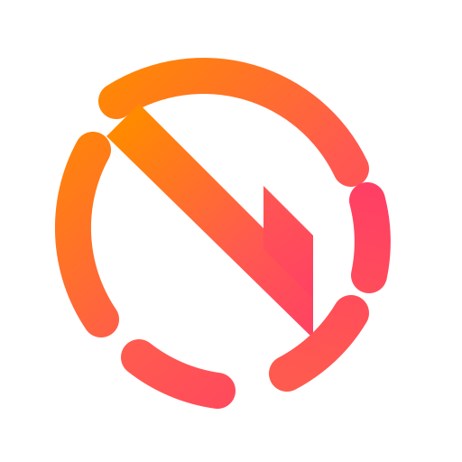

<div align="center">

# NexUI

**Precision Linux Desktop Environment built on Niri, Quickshell & CachyOS**

[](LICENSE)
[](https://wayland.freedesktop.org/)
[](https://github.com/YaLTeR/niri)
[](https://git.outfoxxed.me/outfoxxed/quickshell)
[](https://cachyos.org/)

<p align="center">
  
</p>

*A cohesive, high-performance desktop experience designed by Harinarayanan B. S., guided by restrained optical depth, fluid spatial transitions, intentional ergonomics, and zero AI-rice clutter.*

</div>

---

## Visual Showcase

### Clean Desktop & Dynamic Island


### Centered Application Launcher & Categories


### Control Center & System Telemetry


### Unified Session Matrix


---

## Core Highlights

- **Dynamic Island Topbar**: Continuous compact topbar with a morphing center capsule that adapts fluidly to volume changes, AC charging status, audio playback, and system notifications.
- **Instant Resident Control Center (`SUPER + S`)**: Preloaded control surface providing zero-latency toggles for Wi-Fi, Bluetooth, displays, audio devices, and power profiles.
- **Centered Floating Launcher (`SUPER + Space`)**: Modern, keyboard-driven application menu with category filter chips (`All`, `Internet`, `Dev`, `Media`, `System`, `Utility`).
- **Native Compositor Integration**: Clean, modular configuration driving compositor layout, backdrop blur, and custom animation curves.
- **Hardware Boot Identity (NexBoot)**: Plymouth boot assembly animation seamlessly synchronized with a custom SDDM login greeter.
- **100% Reversible & Safe**: Automated timestamped backups before configuration changes, idempotent installer, and a single-command uninstaller.

---

## Installation

### Method 1: Clone & Inspect (Recommended)
Review the codebase and simulate changes before applying them:

```bash
git clone https://github.com/hari-dev0x/NexOS.git
cd NexOS

# Run a dry-run check:
./install.sh --dry-run

# Execute installation:
./install.sh
```

### Method 2: One-Command Installation
For clean setup on Arch Linux or CachyOS:

```bash
curl -fsSL https://raw.githubusercontent.com/hari-dev0x/NexOS/main/install.sh | bash
```

> [!NOTE]
> Piping remote scripts to bash executes commands directly. Inspect the reviewed [install.sh](https://raw.githubusercontent.com/hari-dev0x/NexOS/main/install.sh) script before running remote commands.

### Installer Flags
| Option | Description |
| :--- | :--- |
| `-y`, `--yes` | Non-interactive mode (auto-accepts prompts) |
| `--dry-run` | Audits dependencies and outputs planned actions without writing to disk |
| `--no-deps` | Skips package manager; installs desktop configurations only |
| `--boot` | Deploys Plymouth boot splash and SDDM greeter (requires root) |
| `--uninstall` | Removes NexUI configurations and offers backup restoration |

---

## Keybindings Cheat Sheet

| Shortcut | Action | Subsystem |
| :--- | :--- | :--- |
| <kbd>SUPER</kbd> + <kbd>Space</kbd> | Toggle Application Launcher | Quickshell IPC |
| <kbd>SUPER</kbd> + <kbd>S</kbd> | Toggle Control Center / Settings | Quickshell IPC |
| <kbd>SUPER</kbd> + <kbd>T</kbd> | Open Terminal (`kitty`) | Compositor |
| <kbd>SUPER</kbd> + <kbd>Q</kbd> | Close Focused Window | Compositor |
| <kbd>SUPER</kbd> + <kbd>N</kbd> | Switch to Next Wallpaper | Quickshell IPC |
| <kbd>SUPER</kbd> + <kbd>SHIFT</kbd> + <kbd>D</kbd> | Toggle Light / Dark Mode | Matugen Theme |
| <kbd>SUPER</kbd> + <kbd>Escape</kbd> | Open Power & Session Menu | Quickshell |
| <kbd>SUPER</kbd> + <kbd>SHIFT</kbd> + <kbd>B</kbd> | Restart Desktop Shell | Systemd Service (`nexui.service`) |
| <kbd>ALT</kbd> + <kbd>Tab</kbd> | Visual Window Switcher | Quickshell IPC |

---

## Documentation

Comprehensive guides, technical references, and operator manuals are available in the [`docs/`](docs/INDEX.md) directory:

- 📖 **[Documentation Hub](docs/INDEX.md)**: Master index and table of contents.
- 🏛️ **[System Architecture](docs/ARCHITECTURE.md)**: Deep dive into the presentation stack, Niri compositor layer, and reactive data flow.
- ⚡ **[Installation Guide](docs/INSTALLATION.md)**: Safe deployment, automated installer flags, and post-install verification.
- ⌨️ **[Keybindings Reference](docs/KEYBINDS.md)**: Complete keyboard shortcut cheat sheet for compositor and shell actions.
- 🎨 **[Configuration Guide](docs/CONFIG.md)**: Guide to themes, presets, transparency, LivingBar morphology, and GameMode.
- ⚙️ **[Services & Lifecycle](docs/SERVICES.md)**: Systemd user unit management (`nexui.service`), crash guard, and IPC socket commands.
- 🪟 **[Niri Integration](docs/NIRI.md)**: Infinite horizontal scrolling, column management, gestures, and layer-shell rules.
- 🧩 **[Desktop Components](docs/COMPONENTS.md)**: Visual breakdown of LivingBar, Control Center, Launcher, and OSDs.
- 🔧 **[Troubleshooting Runbook](docs/TROUBLESHOOTING.md)**: Practical recovery steps for display, audio, duplicate shells, and GPU policies.
- 💻 **[Supported Systems](docs/SUPPORTED_SYSTEMS.md)**: Compatibility matrix across CachyOS, Arch Linux, Fedora, and NixOS.
- 🔄 **[Rollback & Recovery](docs/ROLLBACK.md)**: Uninstallation, configuration snapshots, and state restoration.

---

## Repository Structure

```text
NexOS/ (NexUI)
├── install.sh              # Unified safe installation entry point
├── uninstall.sh            # Idempotent uninstallation & rollback helper
├── LICENSE                 # GNU General Public License v3.0
├── README.md               # Project documentation & visual guide
├── NEXUI_GUIDE.md          # Comprehensive NexUI user & architectural guide
├── assets/
│   ├── branding/           # Vector SVGs and authoritative emblems
│   └── screenshots/        # High-resolution desktop showcase captures
├── config/
│   ├── niri/               # Modular Niri compositor configurations
│   ├── quickshell/         # Quickshell QML shell & LivingBar engine
│   └── boot/               # Plymouth boot splash & SDDM greeter theme
├── docs/
│   ├── INDEX.md            # Master documentation hub and table of contents
│   ├── ARCHITECTURE.md     # In-depth system architecture & layer stack
│   ├── INSTALLATION.md     # Installation details & security guidelines
│   ├── KEYBINDS.md         # Exhaustive keyboard shortcuts reference
│   ├── CONFIG.md           # Configuration system and theming options
│   ├── SERVICES.md         # Systemd user services and IPC architecture
│   ├── NIRI.md             # Niri scrollable-tiling compositor integration
│   ├── COMPONENTS.md       # Breakdown of shell UI surfaces and OSDs
│   ├── TROUBLESHOOTING.md  # Diagnostics and recovery runbook
│   ├── SUPPORTED_SYSTEMS.md# Distribution compatibility matrix
│   └── ROLLBACK.md         # Snapshot restoration and uninstallation steps
└── scripts/
    ├── detect-env.sh       # OS and display environment detection
    ├── check-deps.sh       # Static dependency auditing
    ├── backup.sh           # Non-destructive user configuration snapshot
    ├── install-configs.sh  # Configuration deployment into ~/.config
    └── install-boot.sh     # System boot branding installer
```

---

## Uninstallation & Rollback

To remove NexUI configurations and restore your previous desktop setup:

```bash
./uninstall.sh
```

The uninstaller will clean NexUI-managed directories and offer to restore the most recent pre-install configuration snapshot from `~/.config/nexui-backups/` or `~/.config/nexos-backups/`.

---

## License & Attributions

- **Creator & Author**: [Harinarayanan B. S.](https://github.com/hari-dev0x)
- **License**: [GNU General Public License v3.0 (GPL-3.0)](LICENSE)
- **Upstream & Component Attributions**:
  - Based on iNiR: Copyright (C) [snowarch](https://github.com/snowarch/inir) (GPL-3.0)
  - Based on illogical-impulse: Copyright (C) [end-4](https://github.com/end-4/dots-hyprland) (GPL-3.0)
  - Impasto Top Bar components: Copyright (C) [Andreu Massanet](https://github.com/andreumassanet/impasto) (GPL-3.0)
  - Sea-Shell Base: Copyright (c) 2026 [MiyukiVigil](https://github.com/MiyukiVigil/sea-shell) (MIT)
  - Caelestia Shell: Reference components (GPL-3.0)
